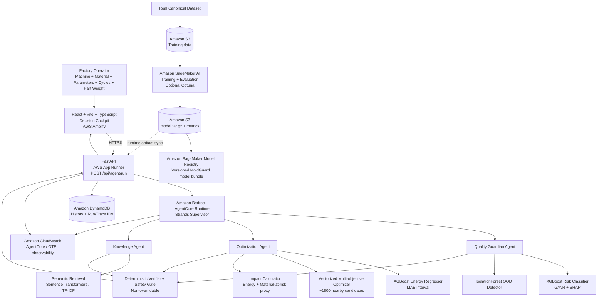

# MoldGuard AI v4 — Complete Implemented Architecture

This document matches the code in this repository. AWS boxes become live when the corresponding resources are deployed/configured.

## Runtime flow

1. Operator enters machine/material/process settings in the React Decision Cockpit.
2. FastAPI validates the request and invokes AgentCore Runtime.
3. The Strands Supervisor delegates to all three specialists:
   - Quality Guardian
   - Optimization Specialist
   - Process Knowledge Specialist
4. Specialists invoke deterministic tools:
   - risk XGBoost + SHAP
   - IsolationForest OOD
   - energy XGBoost
   - constrained optimizer
   - RAG retrieval
5. A deterministic verifier recomputes authoritative values and applies the Safety Gate.
6. The supervisor cannot override the Safety Gate.
7. FastAPI stores the structured result, AgentCore session ID and OTEL trace ID in DynamoDB.
8. The UI shows decision, confidence, OOD status, recommended changes, impact, evidence and human-review requirement.

## Training / MLOps flow

1. Convert real datasets to the canonical schema.
2. Upload canonical training CSV files to S3.
3. Launch the provided SageMaker custom training image/job.
4. Optionally enable Optuna trials inside the SageMaker training job.
5. SageMaker writes `risk_model.joblib`, `energy_model.joblib`, `ood_model.joblib`, `metadata.json` and `training_metrics.json`.
6. Package the artifacts, push the custom inference image to ECR, and register a version in SageMaker Model Registry.
7. FastAPI/App Runner can sync the approved artifacts from S3 at startup.

## Observability

The AgentCore runtime has Strands OTEL support. When AWS observability is enabled:

- CloudWatch GenAI Observability receives agent/tool spans.
- AgentCore runtime metrics include operational latency/errors/session data.
- `/api/agent/run` returns `agent_session_id`, `agent_trace_id` and `agent_span_id` for audit correlation.
- DynamoDB stores those IDs with the full decision record.
